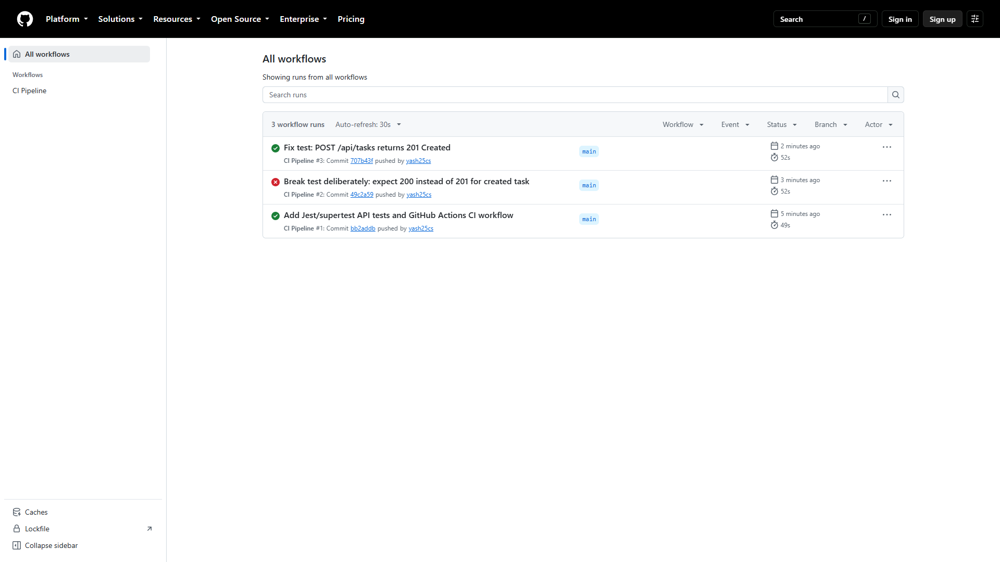
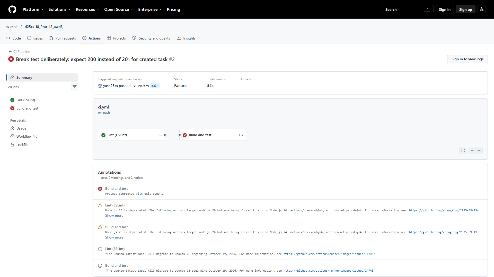
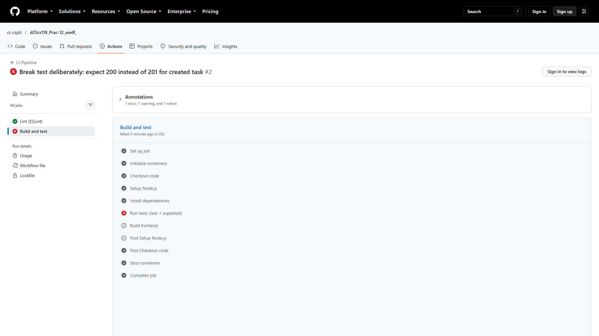
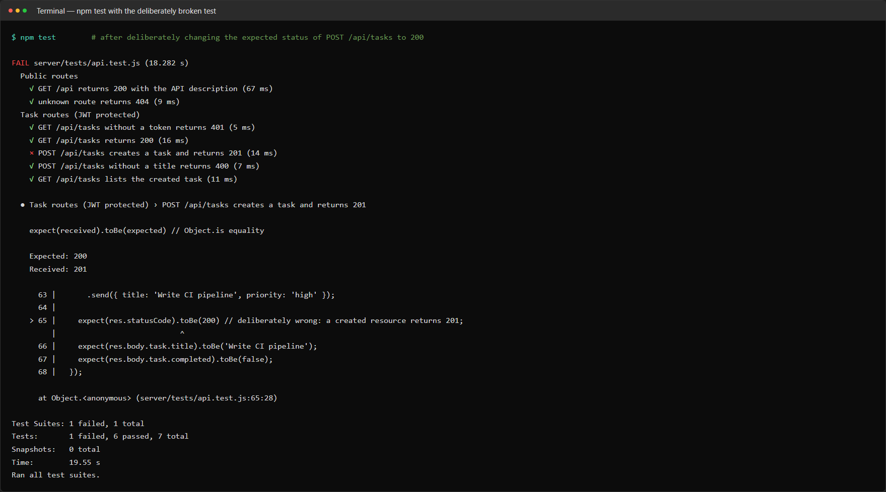
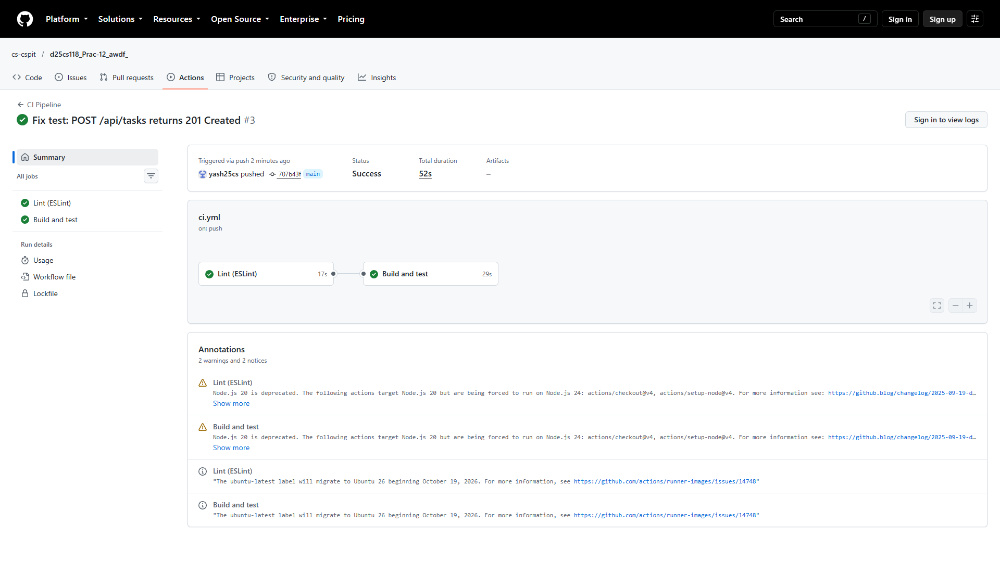
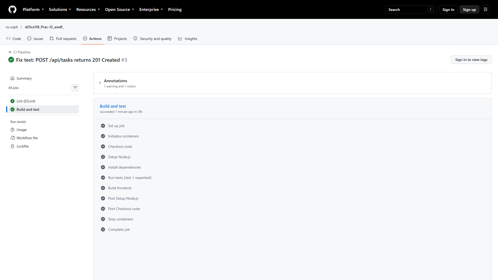

# CI pipeline runs: failed and fixed

| Run | Commit | Result |
|---|---|---|
| [#1](https://github.com/cs-cspit/d25cs118_Prac-12_awdf_/actions/runs/39128823673) | `bb2addb` Add Jest/supertest API tests and GitHub Actions CI workflow | ✔ passed |
| [#2](https://github.com/cs-cspit/d25cs118_Prac-12_awdf_/actions/runs/39128965445) | `49c2a59` Break test deliberately: expect 200 instead of 201 for created task | ✘ **failed** at *Run tests* |
| [#3](https://github.com/cs-cspit/d25cs118_Prac-12_awdf_/actions/runs/39129081714) | `707b43f` Fix test: POST /api/tasks returns 201 Created | ✔ passed |

## Run #2: deliberately broken test → red X

The test `POST /api/tasks creates a task and returns 201` was changed to expect `200`.
The API correctly returns `201 Created`, so the assertion fails. The `Lint` job still passes,
`Build and test` fails at **Run tests (Jest + supertest)**, and **Build frontend** is skipped.

The same test run locally shows the reason that appears in the step log:

## Run #3: test fixed → green check

